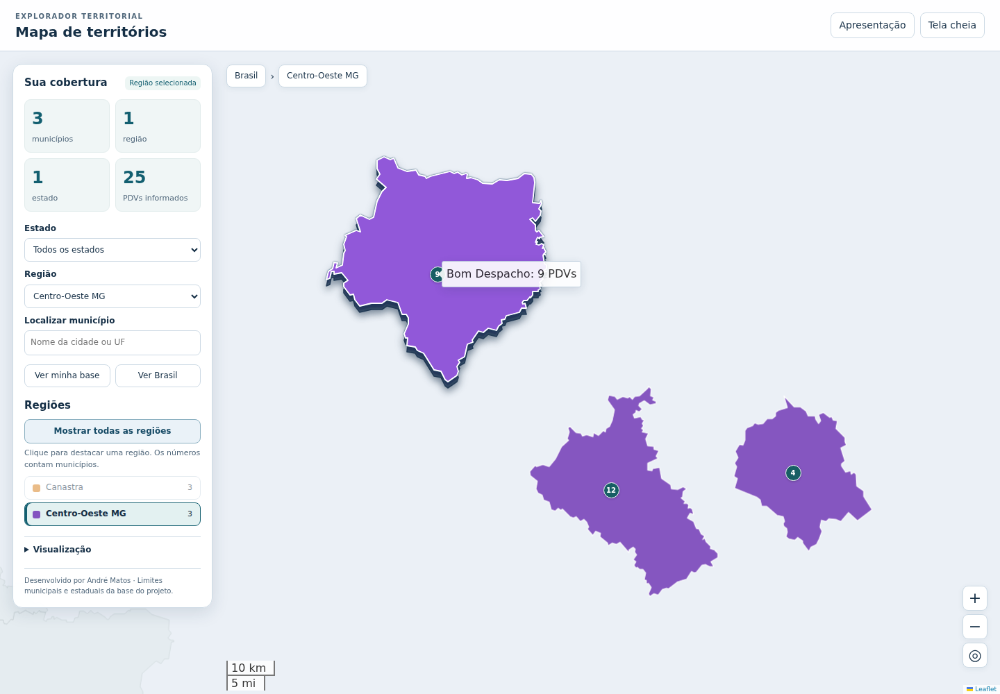

# Mapas Interativos

Aplicação Streamlit para transformar uma planilha de cidades, UFs e regiões em um mapa de cobertura comercial. A versão 2 inclui um explorador territorial com busca, filtros, legenda interativa e painel de detalhes, tanto na prévia quanto no HTML exportado.



## Executar

Python 3.10 ou superior:

```bash
pip install -r requirements.txt
streamlit run app_mapa.py
```

Na lateral, carregue seu Excel `.xlsx`. O botão **Baixar modelo de planilha** fornece somente os cabeçalhos para preenchimento; não carrega nem substitui sua base. Ao remover o arquivo no campo de upload, a aplicação volta à tela inicial.

## Planilha de entrada

| Coluna | Obrigatória | Conteúdo |
| --- | --- | --- |
| Cidade | Sim | Nome do município |
| UF | Sim | Sigla brasileira, por exemplo MG ou SC |
| Região | Sim | Região comercial ou agrupamento definido por você |
| PDVs | Não | Quantidade inteira, maior ou igual a zero |

Também são aceitos os nomes `Qtde PDVs` e `Quantidade PDVs` para a coluna opcional de quantidade. Se houver mais de uma dessas colunas, é usada a primeira nesta ordem: `PDVs`, `Qtde PDVs`, `Quantidade PDVs`. Outras colunas são ignoradas nesta versão.

A associação considera **Cidade + UF**, desconsiderando diferenças de caixa, acentos e espaços. A UF é detectada automaticamente e as malhas são lidas dos arquivos locais do projeto. Não há geocodificação por serviços externos.

### Conferência da importação

A aba **Conferência da planilha** exibe todas as linhas e permite baixar um CSV para correção:

- **Mapeado:** município encontrado na malha.
- **Duplicado consolidado:** repetição de cidade/UF, região e quantidade; entra uma única vez no mapa.
- **Conflito:** cidade/UF com regiões ou quantidades diferentes; todas as ocorrências ficam fora do mapa até a correção. PDVs de duplicatas não são somados.
- **Não encontrado / Nome ambíguo:** exige conferência do nome oficial, da UF ou da malha.
- **Inválido / UF inválida / PDVs inválidos:** dados obrigatórios ausentes ou valores incompatíveis.

Quando a coluna de PDVs existe, uma célula vazia significa **não informado**, enquanto `0` significa nenhum PDV identificado. A soma aparece como parcial se houver valores não informados no recorte. Marcadores representam o total por município em um ponto interior do polígono; não são endereços individuais de estabelecimentos.

## Explorar o mapa

- **Estado e Região:** filtram o resumo e destacam os territórios selecionados. As demais cidades da base ficam discretas como contexto.
- **Busca:** localiza cidades de toda a base, inclusive fora do filtro atual; aceita nomes sem acentos. Enter seleciona o primeiro resultado e Escape limpa a busca.
- **Legenda:** mostra quantos municípios pertencem a cada região. Clique para destacar uma região; clique novamente para remover esse filtro. **Mostrar todas as regiões** limpa os filtros e retorna ao enquadramento da base completa do arquivo.
- **Contraste e relevo:** cores mais vivas, bordas claras e destaque com lateral escura e sombra ao passar o mouse sobre um território. O território selecionado mantém um relevo discreto. Os efeitos são visuais, sem alterar coordenadas nem áreas de clique.
- **Seleção:** clique no município ou no marcador para consultar cidade, UF, região, código IBGE e PDVs, se informados.
- **Navegação:** use o caminho Brasil → UF → Região → Município, os botões Ver minha base / Ver Brasil e os controles de zoom.
- **Cores:** atribuídas à base completa e mantidas ao filtrar ou reordenar a mesma planilha. Regiões com grafias equivalentes são unificadas; até 12 regiões recebem cores distintas da paleta, com variações adicionais para bases maiores. Alterar a composição da base pode reorganizar cores para evitar repetições.
- **Visualização:** permite exibir os limites dos demais municípios das UFs da planilha, nomes dos municípios, quantidades de PDVs e trocar a visão territorial pela geográfica. Nomes aparecem a partir do zoom 8. Marcadores variam de 14 a 24 px conforme o zoom.
- **Apresentação:** oculta busca e configurações, mantendo resumo, legenda e mapa. Tela cheia expande o explorador quando o navegador permite. No celular o painel pode ser recolhido.

## HTML exportado e mapas de fundo

**Baixar mapa interativo em HTML** gera um arquivo independente do Streamlit, com toda a base validada e os mesmos controles de exploração. O arquivo abre inicialmente com a base completa; a seleção momentânea da prévia não é gravada. O título e a configuração inicial de apresentação acompanham a exportação.

A visão **Territorial · fundo limpo** é o padrão. Os polígonos, os dados e o Leaflet acompanham o arquivo, de forma que essa visualização funciona **offline**, sem solicitar imagens de fundo ou bibliotecas a CDNs. A prévia no Streamlit usa exatamente esse HTML.

A visão **Geográfico · ruas e referências** depende de internet e da disponibilidade dos provedores. A seleção automática usa **OpenStreetMap.Mapnik** em páginas HTTP/HTTPS e **Esri WorldTopoMap** no HTML aberto por duplo clique (`file://`), que não envia Referer HTTP. É possível selecionar explicitamente cada provedor. As atribuições são mantidas no mapa. Não há download antecipado ou armazenamento de tiles.

Para usar Mapnik em um HTML local servido por HTTP, na pasta que contém somente os arquivos a compartilhar:

```bash
python -m http.server 8000 --bind 127.0.0.1
```

Abra `http://localhost:8000/mapa_interativo.html`. Política do provedor: https://operations.osmfoundation.org/policies/tiles/.

CARTO é uma alternativa opcional quando a variável `CARTO_API_KEY` contém uma chave configurada. Sem chave, nenhuma camada CARTO é criada. A chave integra URLs públicas no HTML; use uma chave destinada a mapas no navegador e configure limites e restrições no provedor. No PowerShell:

```powershell
$env:CARTO_API_KEY = 'sua-chave'
streamlit run app_mapa.py
```

O mapa mantém as 27 UFs como contexto, mesmo quando a planilha inclui apenas uma. A visão inicial enquadra os municípios da base; **Ver Brasil** restaura o contexto nacional.

## Organização do projeto

- `app_mapa.py`: importação, conferência, prévia e download no Streamlit.
- `mapas/dados.py`: validação, associação por Cidade/UF, consolidação, cores e pontos representativos.
- `mapas/visualizacao.py`: geração do HTML Folium, sem arquivo temporário compartilhado entre sessões.
- `mapas/assets/explorador.*`: interface e interações do explorador, reaproveitadas na prévia e exportação.
- `mapas/assets/vendor/leaflet/`: Leaflet 1.9.4, distribuído com sua licença BSD 2-Clause. Origem: https://github.com/Leaflet/Leaflet/tree/v1.9.4/dist.
- `Json_Polígonos_Geom_Cidades_Brasil/`: malhas municipais por UF.
- `data/estados_brasil.geojson`: união das malhas municipais, preservando as 27 UFs. Para regenerar após atualizar os municípios: `python scripts/gerar_estados.py`.

A associação usa um índice por Cidade/UF, sem percorrer toda a planilha para cada polígono. O explorador cria coleções geográficas no navegador em vez de gerar um objeto Folium separado por cidade. Bases muito grandes ainda produzem HTMLs maiores, pois os polígonos completos são incorporados.

## Validação

Testes de dados, geração do HTML e fluxo do aplicativo:

```bash
python -m unittest discover -s tests -v
```

Os testes de interação são opcionais e ficam habilitados quando Playwright e Chromium estão disponíveis:

```bash
pip install -r requirements-dev.txt
python -m playwright install chromium
python -m unittest discover -s tests -v
```

Para um Chromium já instalado, a variável `MAPAS_BROWSER_EXECUTABLE` pode apontar para seu executável. Os testes verificam busca, filtros, legenda, detalhes, zero versus ausência de PDVs, zoom, apresentação, tela móvel e comportamento dos fundos. A visão territorial é testada com a rede desativada.
